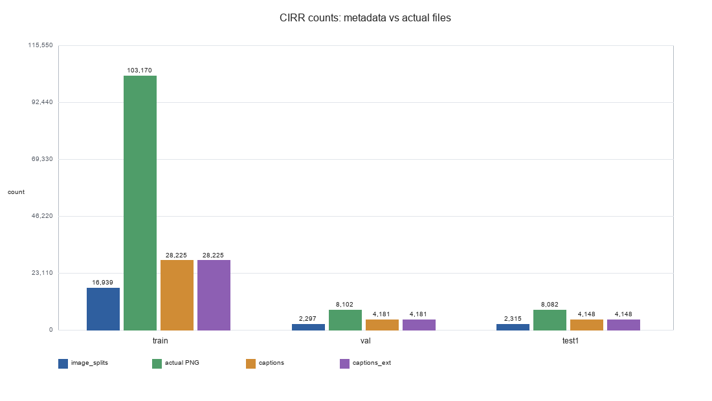
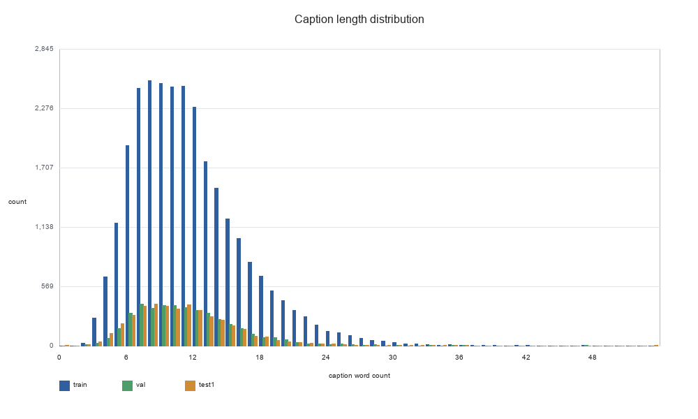
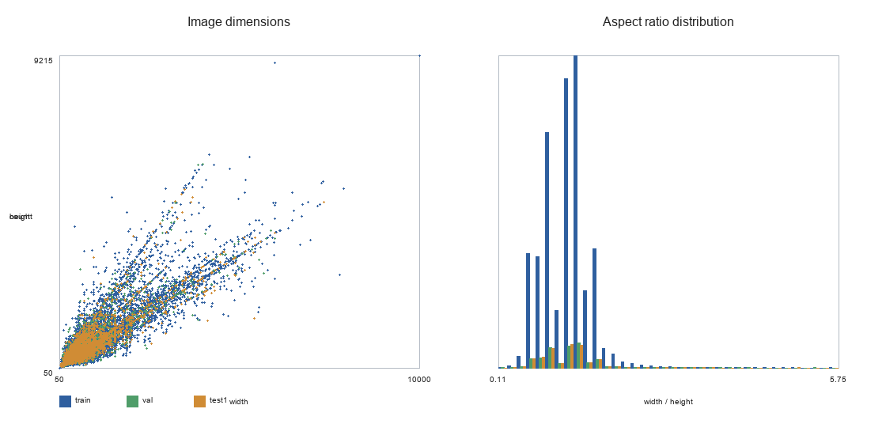
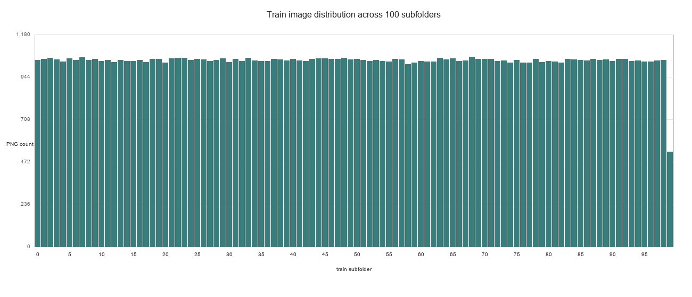
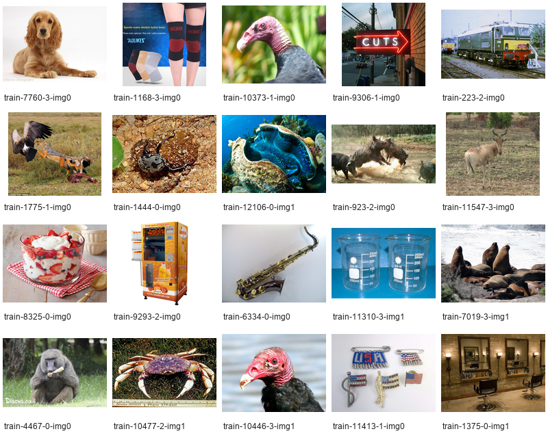
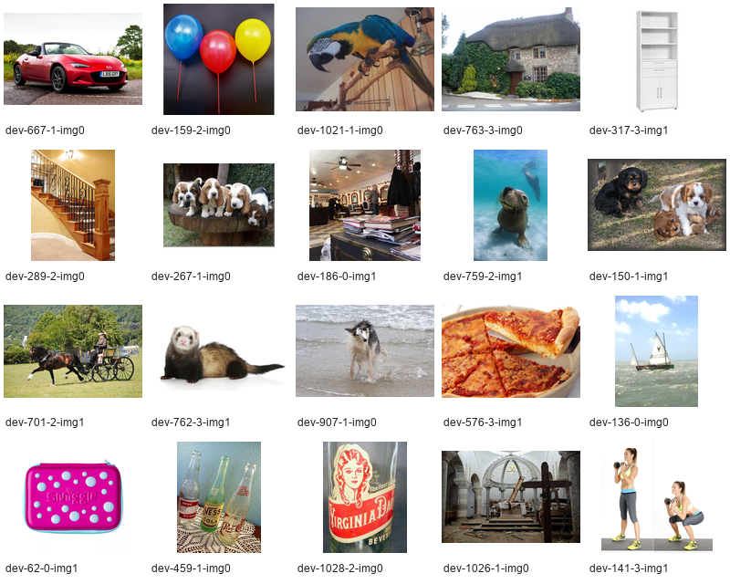
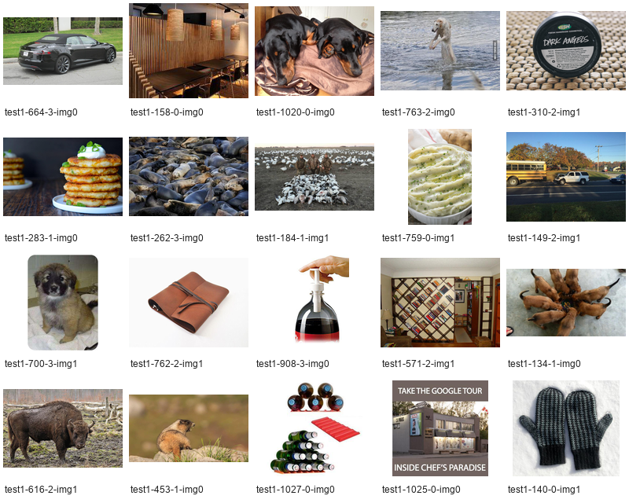

# Báo Cáo Phân Tích Và Trực Quan Hóa Dữ Liệu CIRR

## 1. Mục Tiêu

Báo cáo này phân tích dữ liệu CIRR rc2 trong thư mục local `CIRR` nhằm trả lời ba câu hỏi:

1. Dữ liệu có sạch không?
2. Dữ liệu ảnh local có khớp với metadata gốc không?
3. Khi huấn luyện/đánh giá, nên dùng dữ liệu như thế nào để tránh lấy nhầm ảnh không có nhãn?

Quá trình kiểm tra chỉ đọc dữ liệu trong `CIRR`; không xóa, sửa hoặc di chuyển ảnh/metadata gốc. Các kết quả phân tích và biểu đồ được ghi riêng vào thư mục `cirr_quality_report`.

## 2. Cấu Trúc Dữ Liệu

Ảnh thực tế nằm trong các thư mục:

- `CIRR/train`
- `CIRR/dev`
- `CIRR/test1`

Metadata/annotation gốc nằm trong:

- `CIRR/cirr/image_splits/split.rc2.train.json`
- `CIRR/cirr/image_splits/split.rc2.val.json`
- `CIRR/cirr/image_splits/split.rc2.test1.json`
- `CIRR/cirr/captions/cap.rc2.train.json`
- `CIRR/cirr/captions/cap.rc2.val.json`
- `CIRR/cirr/captions/cap.rc2.test1.json`
- `CIRR/cirr/captions_ext/cap.ext.rc2.*.json`

Lưu ý: split `val` trong metadata tương ứng với thư mục ảnh local `CIRR/dev`.

## 3. Nguồn Metadata Gốc

Thư mục `CIRR/cirr` là một git repository chứa metadata CIRR:

| Thuộc tính | Giá trị |
|---|---|
| Branch | `cirr_dataset` |
| Commit | `2276fba2d2c53862c8ae79ea18e1f1ae03719f56` |
| Working tree | Clean |
| Remote | `git@github.com:Cuberick-Orion/CIRR.git` |

Điều này cho thấy metadata cục bộ chưa bị chỉnh sửa so với trạng thái commit hiện tại.

## 4. Phương Pháp Kiểm Tra

Các bước kiểm tra đã thực hiện:

1. Đọc toàn bộ JSON metadata bằng parser JSON chuẩn.
2. Đếm số ảnh được khai báo trong `image_splits`.
3. Scan toàn bộ PNG thực tế trong `train`, `dev`, `test1`.
4. Đối chiếu từng ảnh trong `image_splits` với file ảnh thật.
5. Kiểm tra ảnh hỏng hoặc ảnh 0 byte bằng Pillow.
6. Kiểm tra cấu trúc caption: `pairid`, `reference`, `target_hard`, `target_soft`, `caption`, `img_set`.
7. Kiểm tra `captions_ext` có khớp `pairid` với `captions` không.
8. Tìm ảnh trùng byte bằng SHA-256.
9. Tạo các biểu đồ trực quan hóa để nhìn phân bố dữ liệu.

## 5. Kết Luận Nhanh

| Hạng mục | Kết quả |
|---|---|
| Metadata gốc sạch trong git | Có |
| Tất cả ảnh được metadata yêu cầu đều tồn tại | Có |
| Có PNG hỏng hoặc 0 byte | Không |
| Có image id trùng giữa các split | Không |
| Folder ảnh khớp 1-1 với `image_splits` | Không |
| Có một vài vấn đề nhỏ trong annotation text | Có |

Kết luận chính:

> Dữ liệu đủ để dùng nếu dataloader đọc theo `image_splits` và `captions`. Tuy nhiên không nên scan toàn bộ thư mục ảnh, vì các thư mục `train/dev/test1` chứa rất nhiều ảnh dư ngoài metadata CIRR rc2.

## 6. Đối Chiếu Ảnh Với Metadata Gốc

`image_splits/*.json` được xem là manifest chính thức: chỉ những ảnh nằm trong các file này mới thuộc subset CIRR rc2 có annotation/label.

| Split | Ảnh được metadata yêu cầu | PNG thực tế trong folder | Ảnh thiếu | Ảnh dư |
|---|---:|---:|---:|---:|
| train | 16,939 | 103,170 | 0 | 86,231 |
| val/dev | 2,297 | 8,102 | 0 | 5,805 |
| test1 | 2,315 | 8,082 | 0 | 5,767 |

Diễn giải:

- Không thiếu ảnh nào mà metadata yêu cầu.
- Tất cả ảnh được metadata tham chiếu đều có file tương ứng trên máy.
- Tuy nhiên folder ảnh local chứa nhiều ảnh hơn metadata chính thức.
- Vì vậy folder ảnh là một superset lớn của subset CIRR rc2.

Có thể hiểu quan hệ này như sau:

```text
Ảnh trong image_splits  ⊂  Ảnh đang nằm trong thư mục train/dev/test1
```

Điều này không có nghĩa ảnh dư bị hỏng. Nó chỉ có nghĩa các ảnh dư không có annotation/label trong CIRR rc2, nên không nên đưa vào train/evaluate nếu làm đúng benchmark.



## 7. Trạng Thái File Ảnh

| Split | PNG thực tế | PNG hỏng | PNG 0 byte |
|---|---:|---:|---:|
| train | 103,170 | 0 | 0 |
| val/dev | 8,102 | 0 | 0 |
| test1 | 8,082 | 0 | 0 |

Kết luận:

- Không phát hiện file PNG hỏng.
- Không phát hiện file PNG rỗng.
- Có một cảnh báo của Pillow về một ảnh có kích thước rất lớn, nhưng ảnh vẫn đọc được. Đây là cảnh báo an toàn khi ảnh vượt ngưỡng pixel mặc định của Pillow, không phải lỗi file.

## 8. Chất Lượng Caption Và Annotation

Số lượng caption:

| Split | `captions` | `captions_ext` |
|---|---:|---:|
| train | 28,225 | 28,225 |
| val | 4,181 | 4,181 |
| test1 | 4,148 | 4,148 |

Kết quả kiểm tra liên kết annotation:

- `reference` đều tồn tại trong split tương ứng.
- `target_hard` đều tồn tại trong split tương ứng đối với train/val.
- Các ảnh trong `img_set.members` đều tồn tại trong split tương ứng.
- Không phát hiện `pairid` bị trùng trong từng split.
- `captions_ext` khớp số lượng với `captions`.

Một số điểm cần lưu ý:

| Vấn đề | Split | Số lượng | Ghi chú |
|---|---|---:|---|
| Caption rỗng | test1 | 1 | pairid `27098` |
| Extended caption rỗng | train | 1 | pairid `1234` |
| `target_hard` không nằm trong positive key của `target_soft` | train | 503 | Cần xử lý theo logic benchmark/model |
| `target_hard` không nằm trong positive key của `target_soft` | val | 40 | Cần xử lý theo logic benchmark/model |

Điểm `target_hard` không nằm trong positive key của `target_soft` không nhất thiết là lỗi ảnh. Nó cho thấy annotation mềm có thể không luôn đặt `target_hard` làm positive trực tiếp. Khi thiết kế loss hoặc đánh giá, cần quyết định dùng `target_hard`, `target_soft`, hoặc cả hai theo đúng protocol.

## 9. Phân Bố Độ Dài Caption

| Split | Min words | Mean | Median | P95 | Max words |
|---|---:|---:|---:|---:|---:|
| train | 2 | 11.29 | 11 | 21 | 47 |
| val | 2 | 11.01 | 10 | 19 | 47 |
| test1 | 0 | 10.70 | 10 | 18 | 53 |

Nhận xét:

- Caption thường ngắn, trung bình khoảng 10-11 từ.
- Phần lớn caption dưới 20 từ.
- `test1` có minimum bằng 0 do một caption rỗng.



## 10. Placeholder Trong `captions_ext`

Trong `captions_ext`, có các placeholder như:

- `[cr0] Nothing worth mentioning`
- `[cr1] Covered in query`
- `[c] None existed`

Đây là annotation hợp lệ, không phải lỗi kỹ thuật. Tuy nhiên nếu dùng text để huấn luyện, cần cân nhắc có giữ các placeholder này hay map chúng sang giá trị đặc biệt.

| Split | `[cr0]` | `[cr1]` | `[c]` |
|---|---:|---:|---:|
| train | 16,435 | 8,723 | 14,862 |
| val | 2,308 | 1,022 | 2,053 |
| test1 | 2,537 | 890 | 2,159 |

## 11. Ảnh Trùng Byte

Khi scan toàn bộ thư mục ảnh, số lượng ảnh trùng byte khá lớn, đặc biệt ở `train`:

| Split | Nhóm trùng byte khi scan toàn folder | Số file nằm trong nhóm trùng |
|---|---:|---:|
| train | 9,449 | 26,557 |
| val/dev | 34 | 72 |
| test1 | 32 | 65 |

Tuy nhiên vì folder chứa rất nhiều ảnh dư, con số này chưa phản ánh chính xác subset CIRR rc2 chính thức. Khi chỉ xét ảnh được `image_splits` tham chiếu:

| Split | Nhóm trùng byte trong subset chính thức | Số file nằm trong nhóm trùng |
|---|---:|---:|
| train | 197 | 404 |
| val/dev | 3 | 6 |
| test1 | 1 | 2 |

Nhận xét:

- Có ảnh trùng byte trong subset chính thức, nhưng tỷ lệ thấp hơn nhiều so với khi scan toàn folder.
- Ảnh trùng byte không tự động có nghĩa dữ liệu sai; một ảnh có thể xuất hiện trong nhiều query/case khác nhau.
- Nếu xây dựng retrieval index theo image id, cần tránh giả định rằng mỗi file ảnh đều có nội dung pixel duy nhất.

## 12. Phân Bố Kích Thước Ảnh

Ảnh có nhiều kích thước khác nhau, không cùng resolution. Một số kích thước phổ biến gồm:

- `1280x720`
- `480x360`
- `800x800`
- `640x480`
- `500x500`
- `1024x768`

Điều này bình thường với dataset ảnh thực tế. Khi đưa vào model, cần resize/crop/normalize trong transform.



## 13. Phân Bố Ảnh Train Theo Subfolder

Ảnh train được chia vào nhiều subfolder đánh số. Biểu đồ dưới đây cho thấy số lượng PNG theo từng subfolder trong `CIRR/train`.



Nhận xét:

- Các subfolder không phải class label.
- Không nên dùng tên subfolder làm nhãn.
- Đường dẫn chính xác của ảnh nên lấy từ `image_splits`, không tự suy luận bằng tên folder.

## 14. Mẫu Ảnh Trực Quan

Các sample sheet dưới đây lấy ngẫu nhiên một số ảnh từ từng split để kiểm tra trực quan.

### Train



### Val/Dev



### Test1



## 15. Giải Thích Rõ Về “Superset”

Trong báo cáo này, “folder ảnh là superset” nghĩa là:

- `image_splits` liệt kê subset ảnh chính thức có annotation.
- Folder ảnh local chứa subset đó cộng thêm rất nhiều ảnh khác.
- Các ảnh thêm này không được CIRR rc2 sử dụng trong metadata hiện tại.

Ví dụ với train:

```text
Ảnh trong folder train:          103,170
Ảnh trong split.rc2.train.json:   16,939
Ảnh dư ngoài metadata:            86,231
```

Vì vậy có thể hiểu:

> Do không phải ảnh nào trong thư mục cũng có label/annotation CIRR rc2, pipeline chỉ nên sử dụng phần ảnh được metadata tham chiếu.

## 16. Ảnh Hưởng Đến Pipeline

Nếu dataloader đọc đúng theo metadata:

```text
image_splits -> lấy danh sách ảnh hợp lệ
captions     -> lấy query, reference, target
captions_ext -> lấy caption mở rộng nếu cần
```

thì dữ liệu có thể dùng được.

Nếu dataloader scan toàn bộ folder:

```python
all_images = list(Path("CIRR/train").rglob("*.png"))
```

thì không nên, vì sẽ lấy cả ảnh không có annotation/label trong CIRR rc2.

## 17. Khuyến Nghị Sử Dụng

1. Không xóa ảnh dư nếu yêu cầu là không làm thay đổi dữ liệu gốc.
2. Không scan toàn bộ folder ảnh để train/evaluate.
3. Luôn đọc ảnh thông qua `image_splits`.
4. Khi train retrieval model, tạo index từ image ids trong `split.rc2.*.json`.
5. Khi đọc query, dùng `captions/cap.rc2.*.json`.
6. Với train/val, cần quyết định rõ dùng `target_hard`, `target_soft`, hay kết hợp cả hai.
7. Với `test1`, lưu ý không có target label đầy đủ như train/val; đây thường là split dùng cho submission/evaluation protocol.
8. Nếu xử lý text, cần quyết định cách xử lý placeholder trong `captions_ext`.

## 18. Kết Luận Cuối

Dữ liệu CIRR local hiện tại:

- Không thiếu ảnh theo metadata gốc.
- Không có PNG hỏng hoặc 0 byte.
- Metadata gốc sạch trong git.
- Không có image id overlap giữa các split.
- Nhưng folder ảnh không khớp 1-1 với `image_splits` vì chứa rất nhiều ảnh dư.

Do đó, dữ liệu không sạch nếu hiểu “sạch” là toàn bộ folder ảnh phải khớp chính xác với manifest. Nhưng dữ liệu vẫn đủ và phù hợp để dùng cho pipeline CIRR nếu dataloader chỉ lấy ảnh qua `image_splits` và annotation qua `captions`.

Tóm tắt ngắn:

```text
Không thiếu ảnh.
Ảnh không hỏng.
Metadata sạch.
Folder ảnh có nhiều ảnh dư.
Không được scan toàn bộ folder.
Phải load theo image_splits + captions.
```

## 19. File Kết Quả

- Báo cáo Markdown: `cirr_quality_report/report.md`
- Kết quả chi tiết dạng JSON: `cirr_quality_report/cirr_quality_report.json`
- Script phân tích: `cirr_quality_report/analyze_cirr_quality.py`
- Biểu đồ số lượng: `cirr_quality_report/counts_overview.png`
- Biểu đồ lỗi cấu trúc: `cirr_quality_report/quality_issues.png`
- Biểu đồ độ dài caption: `cirr_quality_report/caption_length_distribution.png`
- Biểu đồ kích thước ảnh: `cirr_quality_report/image_dimensions.png`
- Biểu đồ phân bố train subfolder: `cirr_quality_report/train_bucket_distribution.png`
- Sample sheet: `cirr_quality_report/sample_sheet_train.png`, `sample_sheet_val.png`, `sample_sheet_test1.png`
